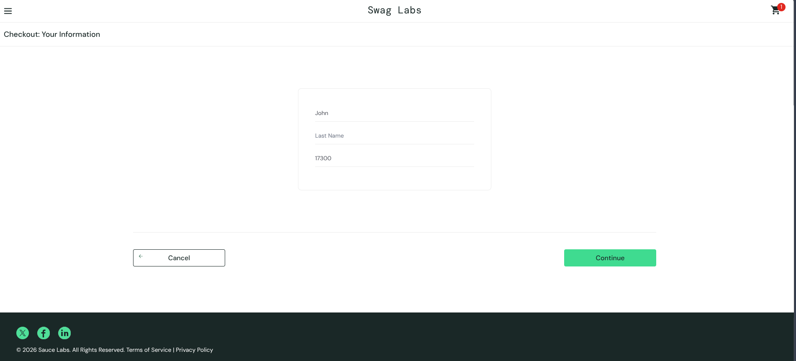

# BUG-002: Cannot enter text into the "Last Name" field on Checkout Step One

**Severity:** Critical (Blocker)
**Priority:** High
**Module:** Checkout
**Environment:** Chrome (latest), Windows 11 — https://www.saucedemo.com/checkout-step-one.html

## Preconditions
Logged in as `standard_user` with at least one item in the cart, navigated to the Checkout: Your Information page.

## Steps to Reproduce
1. Add an item to the cart and click "Checkout".
2. Click on the "First Name" field and type a name (e.g., "John").
3. Click on the "Last Name" field.
4. Type a last name (e.g., "Doe").

## Expected Result
The cursor should focus on the Last Name field, and the text "Doe" should appear in the Last Name box.

## Actual Result
Clicking the Last Name field does not focus the input. Instead, the cursor remains in the First Name field, and typing appends the text to the First Name field (resulting in "JohnDoe" in the First Name box). It is impossible to enter any data into the Last Name field.

## Evidence

## Impact
Users cannot complete the checkout process because the Last Name field is required to proceed. This is a complete blocker for purchasing.
